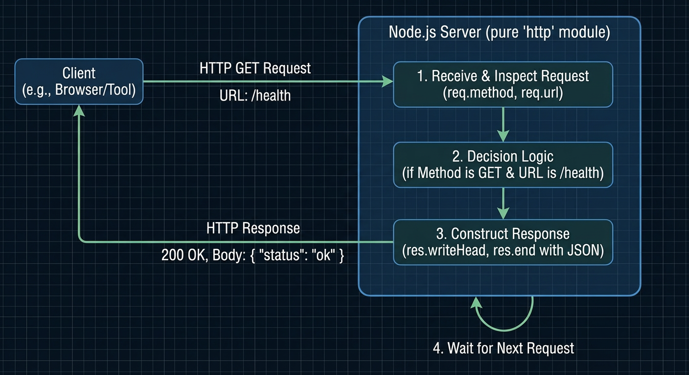

# The Smallest Useful Server

Before we write complex logic, before databases, before authentication, we must answer a deceptively simple question:

**What is a server, really?**

Not in theory.
Not in buzzwords.
But in practice.

This chapter is about building the *smallest* server that is still meaningful, a server that proves you understand the web at its most fundamental level.

---

## Why Servers Exist 

Every system on the web begins with a conversation.

One side **asks**.
The other side **answers**.

That’s it !.

A server exists to **wait**.

It does not initiate.
It does not browse.
It does not click buttons.

It waits for a knock on the door.

When a request arrives, the server:
1. Reads the request
2. Decides what to do
3. Sends back a response
4. Goes back to waiting

That’s the entire job description.

Frameworks don’t change this.
Cloud platforms don’t change this.
Scale doesn’t change this.

If you understand this loop, you understand every backend system ever built.

---

## What We’re Building (And Why It Matters)

We are not building a full API yet.
We are not building business logic.
We are not building authentication.

We are building **proof of life**.

A server that answers one question:

> “Are you alive?”

This is why nearly every real system in production exposes a `/health` endpoint.

Load balancers use it.
Kubernetes uses it.
Monitoring systems depend on it.
Engineers rely on it at 3 a.m.

If you can build this endpoint **from scratch**, you are no longer guessing how servers work.

---

## The Core Idea: Request → Response

Everything you do as a backend engineer fits into this pipeline:


Inside the server, the lifecycle looks like this:

1. The request arrives (method, path, headers, body)
2. Your code inspects it
3. Your code decides how to respond
4. Headers are written
5. A body is sent
6. The connection closes (or stays open)

In Node.js, this lifecycle is exposed *directly*.
No abstractions.
No helpers.
No magic.

Which is why Node is the perfect place to learn this raw.

---

## Building the Smallest Useful Server

Let’s start where everything starts: the Node.js standard library.

We use the built-in `http` module because:
- it is always available
- it shows the raw mechanics
- nothing is hidden from you

At a high level, we will:
- create a server
- listen on a port
- inspect the request
- send a JSON response

No routing yet.
No validation yet.
No middleware yet.

Just fundamentals.

In this repo, the “smallest server” is split into four real production files:

📄src/server.ts → boot the server

📄src/router.ts → parse URL + match route + call handler

📄src/routes.ts → route table (GET /health, GET /ready, etc.)

📄src/handlers/health.ts → actual /health handler

📄src/lib/http.ts → shared JSON response helpers

---

### Step 1: Creating the Server
File: `apps/api/src/server.ts`

A server in Node is just a function that receives two objects:
- the **request**
- the **response**

What this file is responsible for

This file does only two jobs:

- create the server

- tell the server to start listening on a port

It does not contain routing logic. That’s the router’s job.

Breakdown: server.ts 
```ts
1) Load environment variables
import "dotenv/config";
```

This line automatically loads .env when your app starts.

Why it matters:

You don’t want PORT=4000 hardcoded inside your code.

In production, ports/keys change per environment.
```ts
2) Import Node’s HTTP module
import http from "node:http";
```

http is a built-in Node module. It allows you to create a server without Express.
```ts
3) Import the router function
import { handle } from "./router.js";
```

handle is the function that will run on every request.

Think of it like:

“When a request comes in, call handle(req, res) to decide what to do.”
```ts
4) Read config (PORT)
import { config } from "./lib/config.js";
```

Instead of reading process.env.PORT everywhere, we centralize it in config.
```ts
5) Create the server
const server = http.createServer((req, res) => void handle(req, res));
```

This is the most important idea in the chapter:

`http.createServer(...)` expects a function

Node will call that function every time a request arrives

That function receives:

`req` = request info (method, url, headers…)

`res` = response builder (status, headers, body)

We forward all work to the router:

- server receives request

- router handles request
```ts
6) Start listening
server.listen(config.PORT, () => {
  console.log(`API listening on http://localhost:${config.PORT}`);
});
```

Until you call .listen(...), your server exists but nobody can reach it.

listen means:

“Start accepting connections on this port.”

A server that doesn’t listen is useless.

Now the server is alive.
It is waiting.
It is doing nothing by design.

Full code: 
```ts
import "dotenv/config";
import http from "node:http";

import { handle } from "./router.js";
import { config } from "./lib/config.js";

const server = http.createServer((req, res) => void handle(req, res));

server.listen(config.PORT, () => {
  console.log(`API listening on http://localhost:${config.PORT}`);
});
```

### Step 2: Routing (deciding what code runs)

File: `apps/api/src/router.ts`

What routing really means

Routing is simply:

match (HTTP method + path) → call the correct function

For example:

if GET /health → call health()

else → return 404

Frameworks do this automatically.
Here we build it ourselves.

Breakdown: router.ts 
```ts
1) Imports
import type { IncomingMessage, ServerResponse } from "node:http";
import { URL } from "node:url";

import { routes } from "./routes.js";
import type { RequestContext } from "./types.js";
import { sendError } from "./lib/http.js";
```

-IncomingMessage and ServerResponse are Node types for req and res.

-URL lets us safely parse req.url.

-routes is our list of available routes.

-sendError helps us return JSON errors cleanly.

```ts
2) matchRoute function
function matchRoute(method: string, pathname: string) {
  for (const r of routes) {
    if (r.method !== method) continue;

    const match = r.pattern.exec({ pathname });
    if (match) return { route: r, params: match.pathname.groups };
  }
  return null;
}
```

This function loops through routes and tries to find a match.


for (const r of routes)
→ check each route one by one

if (r.method !== method) continue;
→ skip routes that don’t match the HTTP method
Example: if request is GET, skip all POST routes

r.pattern.exec({ pathname })
→ try to match the URL path against the route pattern

Example pattern: /health
If pathname is /health, it matches.

If matched, return:

route: the matched route object

params: route parameters (useful later for /users/:id)

If none matches, return null.
```ts
3) handle(req, res)
export async function handle(req: IncomingMessage, res: ServerResponse) {
```

This is the function server.ts calls for every request.
```ts
4) Convert req.url into a real URL object
const url = new URL(req.url ?? "/", `http://${req.headers.host ?? "localhost"}`);
```

Why this looks weird:

req.url is usually just /health

new URL() needs a full URL like http://localhost/health

So we create the full URL using:

the path from req.url

a base like http://localhost

This gives you url.pathname, url.searchParams, etc.
```ts
5) Create ctx (context)
const ctx: RequestContext = {
  url,
  requestId: "",
  startedAt: Date.now(),
  ip: typeof req.socket.remoteAddress === "string" ? req.socket.remoteAddress : null,
  userAgent: typeof req.headers["user-agent"] === "string" ? req.headers["user-agent"] : null,
  params: {},
};
```

Context is an object we carry across the request.

Why it matters:

every handler can access shared info (ip, userAgent, params)

later you can add auth details: ctx.user = ...
```ts
6) Determine method and pathname
const method = req.method ?? "GET";
const pathname = url.pathname;
```

method: GET/POST/…

pathname: /health
```ts
7) Try to match the route
const matched = matchRoute(method, pathname);
```

Returns either:

a route object + params

or null
```ts
8) If no match, return 404 JSON
if (!matched) {
  return sendError(res, 404, "NOT_FOUND", "Route not found");
}
```

This ensures every unknown request gets a clean JSON error response.
```ts
9) If match, call the handler
ctx.params = matched.params;
await matched.route.handler(req, res, ctx);
```

This is the handoff:

router found the correct function

now it calls it

Handlers are just functions.

Full code:`📄 apps/api/src/router.ts`
```ts
import type { IncomingMessage, ServerResponse } from "node:http";
import { URL } from "node:url";

import { routes } from "./routes.js";
import type { RequestContext } from "./types.js";
import { sendError } from "./lib/http.js";

function matchRoute(method: string, pathname: string) {
  for (const r of routes) {
    if (r.method !== method) continue;

    const match = r.pattern.exec({ pathname });
    if (match) return { route: r, params: match.pathname.groups };
  }
  return null;
}

export async function handle(req: IncomingMessage, res: ServerResponse) {
  const url = new URL(req.url ?? "/", `http://${req.headers.host ?? "localhost"}`);

  const ctx: RequestContext = {
    url,
    requestId: "",
    startedAt: Date.now(),
    ip: typeof req.socket.remoteAddress === "string" ? req.socket.remoteAddress : null,
    userAgent: typeof req.headers["user-agent"] === "string" ? req.headers["user-agent"] : null,
    params: {},
  };

  const method = req.method ?? "GET";
  const pathname = url.pathname;

  const matched = matchRoute(method, pathname);

  if (!matched) {
    return sendError(res, 404, "NOT_FOUND", "Route not found");
  }

  ctx.params = matched.params;
  await matched.route.handler(req, res, ctx);

```
### Step 3: The health handler

File: `📄 apps/api/src/handlers/health.ts `
```ts
import { pool } from "../db/client.js";
import { sendJson } from "../lib/http.js";
import type { Handler } from "../types.js";

export const health: Handler = async (_req, res) => {
  sendJson(res, 200, { status: "ok" });
};

export const ready: Handler = async (_req, res) => {
  await pool.query("select 1");
  sendJson(res, 200, { status: "ready" });
};
```

/health vs /ready (super important)

/health = “Is the server running?”

/ready = “Is the server running AND can it reach dependencies (like DB)?”

What a handler is- 

A handler is a function that receives:

-req (request details)

-res (where you build the response)

- ctx (shared context)

- For health, we only care about res.

- _req starts with underscore because we are not using it yet.

- sendJson sends a JSON response properly.

- sendJson(...) handles headers + JSON formatting for us.

- pool.query("select 1") is the simplest DB test query:

- if DB is down → it throws → error middleware returns a proper response

- if DB is up → returns { status: "ready" }


If the request matches:

- we write headers

- we send JSON

- we end the response

.....If it doesn’t, we can return a basic fallback:

```ts
if (!matched) return sendError(res2, 404, "NOT_FOUND", "Route not found");

```

**This is routing in its rawest form.**

What Just Happened (Slow Down Here)....

Pause!!!

You just:

- handled a real HTTP request

- manually set headers

- returned a JSON response

.....without any framework

> There is no magic here.
This is how every backend system starts.

Everything else: routing libraries, controllers, frameworks  are just organized ways of doing what you just did manually.

### Checkpoint: Proof of Understanding

At this point, you should be able to:

Start the server with node main.ts

Visit http://localhost:3000/health

See this response:

```ts
{ "status": "ok" }
```


If this works:

- your server is alive

- your request handling works

- your response handling works

You are officially writing backend code.

### Why This Chapter Matters:

This chapter is small on purpose.

If you skip understanding this:

- frameworks will confuse you

- debugging will feel impossible

- production issues will feel mysterious

If you master this:

- frameworks become conveniences

- bugs become explainable

- systems become understandable
```ts
        ┌───────────────┐
        │    Client     │
        │ (Browser /    │
        │  Postman)     │
        └───────┬───────┘
                │
        HTTP Request
        (GET /health)
                │
                ▼
┌─────────────────────────────┐
│        Node.js Server       │
│                             │
│  1. Waits for request       │
│  2. Reads method + path     │
│  3. Decides what to do      │
│  4. Sends response          │
│                             │
│  if GET /health → 200 OK    │
│  else → 404 Not Found       │
└─────────────────────────────┘
                │
        HTTP Response
        { "status": "ok" }
                │
                ▼
        ┌───────────────┐
        │    Client     │
        │  sees result  │
        └───────────────┘

        (Server goes back to waiting)
```

>> In this codebase, the “smallest useful server” is not a single file. The server starts in server.ts, but every request is immediately forwarded to the router. That means the app cannot answer even /health unless the router and route list exist. In this chapter we include the routes only to make the server runnable and to show the complete request → response path. The deeper routing design (URLPattern, params, adding many routes) is explained in the routing chapter.