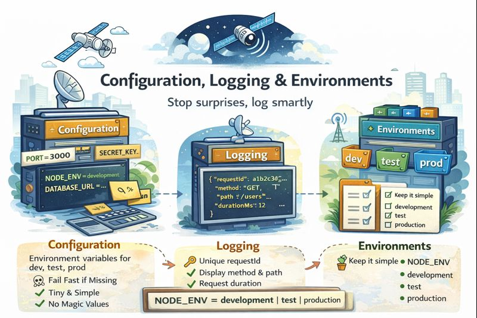

# 4. Configuration, Logging & Environments

If you’ve ever run your code on a different laptop and it “mysteriously” broke…

Or you deployed something and it worked yesterday but not today…

You’ve met the real enemy of software:

> **Surprise....**

This chapter is about removing surprise.

Not with fancy tools.  
Not with complicated setups.

Just with three simple ideas:

1. **Configuration** (what changes between environments)
2. **Logging** (what the app says while it runs)
3. **Environments** (dev vs test vs prod)

---

## A Small Story (Why This Matters)

Imagine you and your friend are both learning AtopBank.

You run:

- `PORT=3000`
- `DATABASE_URL=...`

Your friend runs:

- `PORT=5000`
- wrong database URL

Now your friend says:

> “Your code is not working.”

But your code *is* working.  
Their setup is different.

That’s what configuration is:  
**the part of the system that changes without changing code.**

If configuration is unclear, you don’t get bugs, you get confusion.

---

## What We Want (Simple Goals)

By the end of this chapter:

- The app reads config from environment variables  
- The app fails fast if a required variable is missing  
- Every request gets a `requestId`  
- Logs are structured and predictable  

**Logs show:**
- `requestId`
- `method`
- `path`
- `durationMs`

---

## Environments (Keep It Simple)

Think of environments like three “worlds”:

- **dev** → your laptop (messy but fast)
- **test** → automated tests (repeatable)
- **prod** → real users (strict)

We don’t need a complicated system.

We only need:

- `NODE_ENV=development | test | production`

That’s enough.

---

## Step 1 - A Tiny Config Loader

Create:

📄 `apps/api/src/lib/config.ts`

```ts
type Env = "development" | "test" | "production";

function required(name: string): string {
  const value = process.env[name];
  if (!value) throw new Error(`Missing required env var: ${name}`);
  return value;
}

export const config = {
  env: (process.env.NODE_ENV ?? "development") as Env,
  port: Number(process.env.PORT ?? "3000"),
  databaseUrl: required("DATABASE_URL"),
  jwtAccessSecret: required("JWT_ACCESS_SECRET"),
  jwtRefreshSecret: required("JWT_REFRESH_SECRET"),
};
```

Why this is good..

- It’s tiny

- It forces correctness

- It fails early (good!)

- No magic

## Step 2 - A Tiny Logger (That Doesn’t Lie)
Create:

📄 apps/api/src/lib/log.ts
```ts
type LogLevel = "info" | "error";

export function log(level: LogLevel, message: string, meta: Record<string, unknown> = {}) {
  const entry = {
    level,
    message,
    time: new Date().toISOString(),
    ...meta,
  };

  // JSON logs are easy to search later
  console.log(JSON.stringify(entry));
}

export const logger = {
  info: (message: string, meta?: Record<string, unknown>) => log("info", message, meta),
  error: (message: string, meta?: Record<string, unknown>) => log("error", message, meta),
};
```
`Story: why JSON logs?`

In production, you don’t read logs like a novel.

You search logs.

JSON logs make that possible.

## Step 3 - Give Every Request a requestId
Create:

📄 apps/api/src/lib/requestId.ts

```ts
import crypto from "node:crypto";

export function makeRequestId() {
  return crypto.randomBytes(12).toString("hex");
}
```
Now every request can have a unique ID like:

`a3f9b6c91d2e4b7c8a11ff02`

## Step 4 - Log Every Request (Method, Path, Duration)
In your server.ts (or wherever your server callback lives):
```ts
import http from "node:http";
import { config } from "./lib/config";
import { logger } from "./lib/log";
import { makeRequestId } from "./lib/requestId";

const server = http.createServer(async (req, res) => {
  const start = Date.now();
  const requestId = makeRequestId();

  const method = req.method ?? "GET";
  const url = new URL(req.url ?? "/", `http://${req.headers.host}`);
  const path = url.pathname;

  // attach requestId so handlers can use it too
  (req as any).requestId = requestId;

  res.on("finish", () => {
    const durationMs = Date.now() - start;

    logger.info("request", {
      requestId,
      method,
      path,
      statusCode: res.statusCode,
      durationMs,
    });
  });

  // your router goes here...
  // route.handler(req, res)

  // demo fallback:
  res.statusCode = 404;
  res.end("Not found");
});

server.listen(config.port, () => {
  logger.info("server_started", { port: config.port, env: config.env });
});

```

What This Gives You (Why It’s Powerful)

Now when someone says:

“The API is slow.”

You don’t guess.

You look at logs:

which endpoint?

how long?

which request?

That’s why request IDs matter.

## Checkpoint

When you hit any endpoint, you should see logs like:

```ts
{
  "level": "info",
  "message": "request",
  "time": "2026-01-18T10:10:10.000Z",
  "requestId": "c2f3e9a5c0d6c8f4a1b2c3d4",
  "method": "GET",
  "path": "/health",
  "statusCode": 200,
  "durationMs": 2
}
```
And when the server starts:

```ts
{
  "level": "info",
  "message": "server_started",
  "time": "...",
  "port": 3000,
  "env": "development"
}
```
## Common Mistakes (Keep These in Mind)
1) Not failing fast
If DATABASE_URL is missing, don’t limp.
Fail early, with a clear message.

2) Logging random text
Text logs are hard to search.
JSON logs are easy.

3) No requestId
When multiple requests happen, logs become messy.
A requestId turns chaos into a story.

A Final Story (Why Professionals Love This)
Imagine your app has 100 users.

One user says:

“I clicked send money, and it failed.”

If your logs are clean, you ask:

- “What time did it happen?”

- “What’s your requestId?”

Then you find the exact failure in seconds.

That’s what observability is.

Not fancy dashboards.

Just clarity.
```ts
        ┌──────────────────────────────┐
        │        ENVIRONMENT            │
        │  development | test | prod    │
        │                              │
        │ NODE_ENV                      │
        │ PORT                          │
        │ DATABASE_URL                  │
        │ JWT_SECRETS                   │
        └───────────────┬──────────────┘
                        │
                        ▼
        ┌──────────────────────────────┐
        │        CONFIG LOADER          │
        │        config.ts              │
        │                              │
        │ • read env vars               │
        │ • validate required values   │
        │ • fail fast if missing       │
        └───────────────┬──────────────┘
                        │
                        ▼
┌──────────────┐   ┌────────────────────────────────┐
│   CLIENT     │   │        NODE.JS SERVER           │
│              │   │                                │
│ HTTP REQUEST │──▶│ 1. generate requestId          │
│              │   │ 2. parse method + path          │
└──────────────┘   │ 3. handle request               │
                   │                                │
                   │   ┌──────────────────────────┐ │
                   │   │   ROUTER + HANDLERS       │ │
                   │   │   (business logic)        │ │
                   │   └──────────────────────────┘ │
                   │                                │
                   │  response sent                 │
                   │  res.on("finish")              │
                   └───────────────┬────────────────┘
                                   │
                                   ▼
                   ┌────────────────────────────────┐
                   │            LOGGER               │
                   │            log.ts               │
                   │                                │
                   │ JSON log entry:                 │
                   │ • requestId                    │
                   │ • method                       │
                   │ • path                         │
                   │ • statusCode                   │
                   │ • durationMs                   │
                   │ • time                         │
                   └────────────────────────────────┘
```