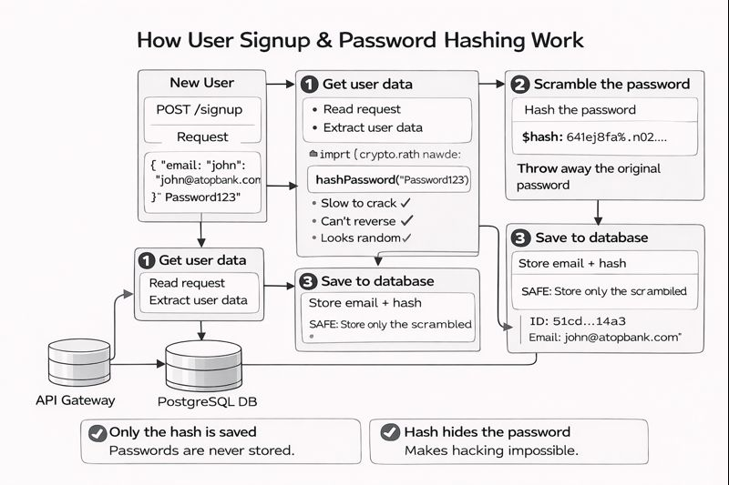

# 5.  Users & Passwords 

Before we talk about login, tokens, or security words, we need to answer a very basic question:

> **How does a computer know who someone is?**

Humans recognize faces.  
Computers don’t.

Computers only understand **data**.

So when someone says:
> “This is me”

The computer asks:
> “Prove it.”

This chapter is about **that proof**.

---

## Let’s Start With a Story 

Imagine a notebook at a bank front desk.

When someone comes to open an account, the clerk writes:

Name: John
Password: mypassword123


That notebook is dangerous.

Anyone who opens it can:
- see passwords
- pretend to be anyone
- steal money

So real banks **never** write passwords down.

Instead, they do this:

1. Take the password
2. Scramble it in a special way
3. Throw the original password away
4. Store only the scrambled version

That scrambled version is called a **hash**.

---

## Important Rule (Memorize This)

> **Passwords are never stored. Ever.**

Only hashes are stored.

If you remember only one thing from this chapter, remember that.

---

## What We Are Building (No Magic)

By the end of this chapter:

- A user can sign up with email + password  
- The password is scrambled (hashed)  
- The real password is never saved  
- The database stores only the hash  

No login yet.  
No tokens yet.  
Just signup.

---

## Step 1 - Where Do Users Live?

Users live in the **database**.

So first, we create a table.

### Create the users table

📄 `apps/api/src/db/migrations/0001_users.sql`

```sql
CREATE TABLE users (
  id UUID PRIMARY KEY,
  email TEXT NOT NULL UNIQUE,
  password_hash TEXT NOT NULL,
  created_at TIMESTAMPTZ NOT NULL DEFAULT now()
);
```
Explanation...

- id:
A unique identifier. We use UUID so it’s hard to guess.

- email:
The user’s email.
UNIQUE means no two users can share the same email.

- password_hash: 
This is NOT the password.
This is the scrambled version.

- created_at: 
When the user was created.

That’s it. Nothing fancy.

## Step 2 - Scrambling Passwords (Hashing)

We need a tool that:

...is slow on purpose

...is hard to reverse

...is trusted by professionals

That tool is called argon2.

Install it

>>npm install argon2

## Step 3 - A Tiny Password Helper

We do NOT want hashing logic everywhere.

So we wrap it in one file.

📄 apps/api/src/lib/password.ts


import argon2 from "argon2";

 * Takes a plain password like "Password123"
 * Returns a scrambled string (hash)
```ts
export async function hashPassword(password: string) {
  return argon2.hash(password);
}
```


 * Takes a stored hash and a plain password
 * Returns true or false
 ```ts
export async function verifyPassword(hash: string, password: string) {
  return argon2.verify(hash, password);
}
```
Explanation...


input: real password

output: scrambled version

original password is lost forever

verifyPassword

checks if a password matches a hash

used later during login

For now, we only need hashPassword.

## Step 4 - Saving a User to the Database
Now we write code that inserts a user.

📄 apps/api/src/db/users.ts

```ts
import crypto from "node:crypto";
import { pool } from "./client";

/**
 * Saves a new user in the database
 */
export async function createUser(email: string, passwordHash: string) {
  const id = crypto.randomUUID();

  await pool.query(
    `
    INSERT INTO users (id, email, password_hash)
    VALUES ($1, $2, $3)
    `,
    [id, email, passwordHash]
  );

  return { id, email };
}
```
Explanation
crypto.randomUUID()
Generates a unique ID.

pool.query(...)
Sends SQL to PostgreSQL.

$1, $2, $3
These are placeholders (safe from SQL injection).

We return { id, email }
We do NOT return the password hash.


## Step 5 - Reading the Request (Signup)
Now the user sends this:

```ts
{
  "email": "john@atopbank.com",
  "password": "Password123"
```
Our job:

read it

hash the password

save the user

Step 6 - Signup Handler (Very Simple)
📄 apps/api/src/handlers/auth/signup.ts

```ts
import { hashPassword } from "../../lib/password";
import { createUser } from "../../db/users";

export async function signup(req: any, res: any) {
  const { email, password } = req.body;

  // Step 1: check input
  if (!email || !password) {
    res.writeHead(400, { "Content-Type": "application/json" });
    res.end(JSON.stringify({ error: "email and password are required" }));
    return;
  }

  // Step 2: scramble password
  const passwordHash = await hashPassword(password);

  // Step 3: save user
  const user = await createUser(email, passwordHash);

  // Step 4: respond
  res.writeHead(201, { "Content-Type": "application/json" });
  res.end(JSON.stringify({ user }));
}
Explanation (line by line)
req.body
Contains the JSON sent by the user.

if (!email || !password)
Basic safety check.

hashPassword(password)
Scrambles the password.

createUser(...)
Saves user in the database.

201
Means “created successfully”.
```

## Step 7 - Connecting the Route
Add this route to your router:

```ts
{
  method: "POST",
  path: "/v1/auth/signup",
  handler: signup
}
```
Now the server knows where to send signup requests.

Checkpoint (Very Important)
Run the server and send:

```ts
POST /v1/auth/signup
Content-Type: application/json

{
  "email": "john@atopbank.com",
  "password": "Password123"
}
```
What should happen?
- User is saved

- Password is NOT stored

- Database contains only password_hash

If that works, you’ve done it correctly.

What You Just Learned (In Simple Words)
You learned how to:

- protect passwords

- store users safely

- build real signup logic

- avoid beginner security mistakes

This is real backend engineering.

Very Important Reminder
If someone steals your database:

- they should NOT be able to log in

- they should NOT see passwords

- they should NOT recover accounts

This chapter makes that possible!!!

