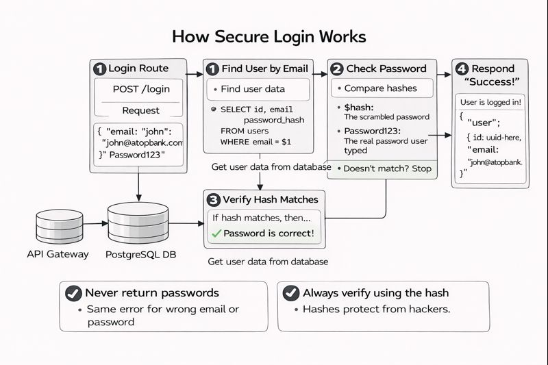

# 6. Login 

Signup created a user.  
Login proves that the user is the **same person**.

Nothing more.

---

## What Login Really Is

Login is just this question:

> “Does the password you typed match the one we saved earlier?”

That’s it.

If it matches → login succeeds  
If it doesn’t → login fails

---

## What We Will Build

By the end of this chapter:

- User can log in with email + password  
- Password is checked safely  
- No password is returned  
- A simple success response is sent  

(No JWT yet. No sessions yet.)

---

## Step 1 - Find User by Email

We need to **look up a user**.

📄 `apps/api/src/db/users.ts`  
We add this function below `createUser`

```ts
export async function findUserByEmail(email: string) {
  const result = await pool.query(
    `
    SELECT id, email, password_hash
    FROM users
    WHERE email = $1
    `,
    [email]
  );

  return result.rows[0] ?? null;
}
```
What this does
Searches the database

Returns the user if found

Returns null if not found

## Step 2 - Login Handler
📄 apps/api/src/handlers/auth/login.ts

```ts
import { findUserByEmail } from "../../db/users";
import { verifyPassword } from "../../lib/password";

export async function login(req: any, res: any) {
  const { email, password } = req.body;

  // basic check
  if (!email || !password) {
    res.writeHead(400, { "Content-Type": "application/json" });
    res.end(JSON.stringify({ error: "email and password are required" }));
    return;
  }

  // find user
  const user = await findUserByEmail(email);

  if (!user) {
    res.writeHead(401, { "Content-Type": "application/json" });
    res.end(JSON.stringify({ error: "invalid credentials" }));
    return;
  }

  // check password
  const isValid = await verifyPassword(user.password_hash, password);

  if (!isValid) {
    res.writeHead(401, { "Content-Type": "application/json" });
    res.end(JSON.stringify({ error: "invalid credentials" }));
    return;
  }

  // success
  res.writeHead(200, { "Content-Type": "application/json" });
  res.end(JSON.stringify({
    user: {
      id: user.id,
      email: user.email
    }
  }));
}
```
Step 3 - Wire the Route
Add this route:

```ts
{
  method: "POST",
  path: "/v1/auth/login",
  handler: login
}
```
## Step 4 - Test It
Request!
```ts
POST /v1/auth/login
Content-Type: application/json

{
  "email": "john@atopbank.com",
  "password": "Password123"
}
```
Response!
```ts
{
  "user": {
    "id": "uuid-here",
    "email": "john@atopbank.com"
  }
}
```
If password is wrong:

```ts
{
  "error": "invalid credentials"
}
```
> Important Rules 

- Never return passwords

- Same error for wrong email or password

- Always verify using the hash

> Checkpoint
You are done when:

- signup works

- login works

- wrong password fails

- database never exposes passwords

