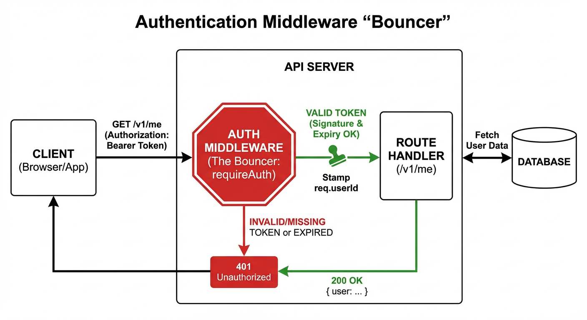

# 7. Protecting Routes (Auth Middleware)

You have tokens now.

But tokens are useless unless the server can do this:

> “Only logged-in users can access this route.”

That’s what **protecting routes** means.

---

## Simple Story

Imagine a club.

At the door, a bouncer checks your wristband.

- If you have it → you enter
- If you don’t → you go home

The bouncer does the same check for everybody, every time.

That bouncer is your **auth middleware**.

It’s just a reusable function that runs **before** the real handler.

---

## What We Will Build

By the end:

- A `requireAuth()` function (your bouncer)  
- Protected routes call it first  
- `/v1/me` works only when logged in  

---

## The Rule 

A protected route must do this:

1) Read `Authorization` header  
2) Confirm it starts with `Bearer `  
3) Verify the token signature + expiry  
4) Extract `userId` from token payload  
5) Put `userId` on `req` so handlers can use it  

If any step fails → return `401 Unauthorized`

---

## Step 1 - What Header Are We Checking?

The client sends this on protected routes:

Authorization: Bearer ACCESS_TOKEN_HERE


- `Authorization` is the header name
- `Bearer` means “I am sending a token”
- The token is the access token from login

---

## Step 2 - Middleware Function (The Bouncer)

Create:

📄 `apps/api/src/lib/auth.ts`

```ts
import { verifyToken } from "./jwt";
import { config } from "./config";

export function requireAuth(req: any, res: any) {
  // 1) Read header
  const authHeader = req.headers.authorization;

  // 2) Must exist and start with "Bearer "
  if (!authHeader || !authHeader.startsWith("Bearer ")) {
    res.writeHead(401, { "Content-Type": "application/json" });
    res.end(JSON.stringify({ error: "Unauthorized" }));
    return null;
  }

  // 3) Extract token (remove "Bearer ")
  const token = authHeader.slice("Bearer ".length);

  // 4) Verify token using access secret
  const payload = verifyToken(token, config.jwtAccessSecret);

  if (!payload) {
    res.writeHead(401, { "Content-Type": "application/json" });
    res.end(JSON.stringify({ error: "Unauthorized" }));
    return null;
  }

  // 5) Save userId on req for later handlers
  req.userId = payload.sub;

  return payload;
}
```
Explanation....
- If header is missing → not logged in

- If token is invalid → not logged in

- If token is expired → not logged in

- If token is valid → attach req.userId

So now handlers can know who is calling.

## Step 3 - Protect a Route (Example)
Here’s what a protected handler looks like:

```ts
import { requireAuth } from "../lib/auth";

export function protectedExample(req: any, res: any) {
  const auth = requireAuth(req, res);

  // if auth failed, response already sent
  if (!auth) return;

  // now safe
  res.writeHead(200, { "Content-Type": "application/json" });
  res.end(JSON.stringify({ message: "You are allowed", userId: req.userId }));
}
```
`Important idea`

If requireAuth() fails, it sends the 401 response and returns null.

So the handler must stop.

## Step 4 - Build /v1/me

> /v1/me means:

“Give me my own user profile.”

But we need req.userId to know who “me” is.

Add DB function: find user by id
📄 apps/api/src/db/users.ts

```ts
export async function findUserById(id: string) {
  const result = await pool.query(
    `
    SELECT id, email, created_at
    FROM users
    WHERE id = $1
    `,
    [id]
  );

  return result.rows[0] ?? null;
}
```
Create handler: me
📄 apps/api/src/handlers/me.ts

```ts
import { requireAuth } from "../lib/auth";
import { findUserById } from "../db/users";

export async function me(req: any, res: any) {
  const auth = requireAuth(req, res);
  if (!auth) return;

  const user = await findUserById(req.userId);

  if (!user) {
    res.writeHead(404, { "Content-Type": "application/json" });
    res.end(JSON.stringify({ error: "User not found" }));
    return;
  }

  res.writeHead(200, { "Content-Type": "application/json" });
  res.end(JSON.stringify({ user }));
}
```
## Step 5 - Wire the Route
Add route:

```ts
{
  method: "GET",
  path: "/v1/me",
  handler: me
}
```
Test It
1) No token

GET /v1/me
→ 401 Unauthorized

2) With token

GET /v1/me
Authorization: Bearer ACCESS_TOKEN

→ returns your user data

Checkpoint
You are done when:

- /v1/me fails without token
- /v1/me works with valid access token
- Expired token fails

>Common Mistakes...
- Not using Bearer

- Using refresh token instead of access token

- Forgetting if (!auth) return;

