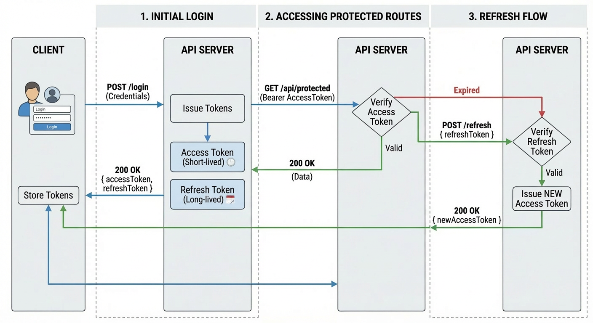

# 6.5. Sessions & JWT (Access and Refresh Tokens)

Login answers one question:

> “Are you who you say you are?”

Sessions answer a different question:

> “Do I still trust you?”

This chapter is about **keeping users logged in safely**.

---

## A Simple Story (Very Important)

Imagine a bank security guard.

When you enter the bank:
- the guard checks your ID
- then gives you a wristband

As long as you wear the wristband:
- you can move around
- you don’t show ID again

But:
- the wristband expires
- if it’s stolen, it should stop working
- if you leave the bank, it should be invalidated

That wristband is a **session**.

---

## Why We Don’t Check Password Every Time

We could do this:

- every request → ask for email + password

That would be:
- slow
- dangerous
- annoying

So instead:
- user logs in once
- we give them **tokens**
- tokens prove identity without exposing password

---

## Two Tokens, Two Jobs

We use **two tokens**, not one.

### 1) Access Token
- short-lived (e.g. 15 minutes)
- sent with every request
- used to access protected routes

### 2) Refresh Token
- long-lived (e.g. 7 days)
- stored securely
- used to get a new access token

If access token expires → use refresh token  
If refresh token expires → login again

---

## What We Will Build

By the end of this chapter:

- Login returns **accessToken + refreshToken**  
- Access token expires quickly  
- Refresh token lives longer  
- Tokens are signed and verified manually  
- Protected routes check access token  

---

## Important Rule (Keep This Simple)

> A token is just a signed message.

It contains:
- who the user is
- when it expires
- a signature to prevent tampering

---

## Step 1 - What Is a JWT (In Plain Words)

A JWT has **three parts**:

header.payload.signature


Each part is:
- JSON
- base64 encoded
- joined with dots

We will build this ourselves.

---

## Step 2 - Helper: Base64 URL Encode

JWT uses **URL-safe base64**.

Create:

📄 `apps/api/src/lib/base64.ts`

```ts
export function base64UrlEncode(input: string) {
  return Buffer.from(input)
    .toString("base64")
    .replace(/=/g, "")
    .replace(/\+/g, "-")
    .replace(/\//g, "_");
}

export function base64UrlDecode(input: string) {
  input = input.replace(/-/g, "+").replace(/_/g, "/");
  return Buffer.from(input, "base64").toString();
}
```
Step 3 - Sign Data (The Most Important Part)
We use a secret key to sign tokens.

Create:

📄 apps/api/src/lib/jwt.ts

```ts
import crypto from "node:crypto";
import { base64UrlEncode, base64UrlDecode } from "./base64";

type JwtPayload = {
  sub: string;     // user id
  exp: number;     // expiration timestamp
};

function sign(data: string, secret: string) {
  return crypto
    .createHmac("sha256", secret)
    .update(data)
    .digest("base64url");
}
```
Step 4 - Create a JWT 
Still in jwt.ts:

```ts
export function createToken(
  payload: JwtPayload,
  secret: string
) {
  const header = {
    alg: "HS256",
    typ: "JWT",
  };

  const encodedHeader = base64UrlEncode(JSON.stringify(header));
  const encodedPayload = base64UrlEncode(JSON.stringify(payload));

  const data = `${encodedHeader}.${encodedPayload}`;
  const signature = sign(data, secret);

  return `${data}.${signature}`;
}
```
Explanation..

header → says how token is signed

payload → contains user info + expiry

signature → prevents tampering

## Step 5 - Verify a JWT
Add this to jwt.ts:

```ts
export function verifyToken(token: string, secret: string) {
  const parts = token.split(".");
  if (parts.length !== 3) return null;

  const [header, payload, signature] = parts;
  const data = `${header}.${payload}`;
  const expected = sign(data, secret);

  if (expected !== signature) return null;

  const decoded = JSON.parse(base64UrlDecode(payload));

  if (Date.now() / 1000 > decoded.exp) return null;

  return decoded;
}
```
What this checks..

- token format

- signature validity

- expiration time

If anything is wrong → return null

## Step 6 - Issue Tokens on Login
Update login handler:

📄 apps/api/src/handlers/auth/login.ts

```ts
import { createToken } from "../../lib/jwt";
import { config } from "../../lib/config";

const ACCESS_TTL = 60 * 15;       // 15 minutes
const REFRESH_TTL = 60 * 60 * 24 * 7; // 7 days

```
Inside successful login:

```ts
const now = Math.floor(Date.now() / 1000);

const accessToken = createToken(
  { sub: user.id, exp: now + ACCESS_TTL },
  config.jwtAccessSecret
);

const refreshToken = createToken(
  { sub: user.id, exp: now + REFRESH_TTL },
  config.jwtRefreshSecret
);

res.writeHead(200, { "Content-Type": "application/json" });
res.end(JSON.stringify({
  accessToken,
  refreshToken
}));
```
## Step 7 - Protect Routes with Access Token
Create middleware-style helper:

📄 apps/api/src/lib/auth.ts
```ts
import { verifyToken } from "./jwt";
import { config } from "./config";

export function requireAuth(req: any, res: any) {
  const auth = req.headers.authorization;

  if (!auth || !auth.startsWith("Bearer ")) {
    res.writeHead(401);
    res.end("Unauthorized");
    return null;
  }

  const token = auth.replace("Bearer ", "");
  const payload = verifyToken(token, config.jwtAccessSecret);

  if (!payload) {
    res.writeHead(401);
    res.end("Unauthorized");
    return null;
  }

  req.userId = payload.sub;
  return payload;
}
```
Use this inside handlers.

```ts
## Step 8 - Refresh Token Flow
Create handler:

📄 apps/api/src/handlers/auth/refresh.ts

```ts 
import { verifyToken, createToken } from "../../lib/jwt";
import { config } from "../../lib/config";

export function refresh(req: any, res: any) {
  const { refreshToken } = req.body;

  if (!refreshToken) {
    res.writeHead(400);
    res.end("refreshToken required");
    return;
  }

  const payload = verifyToken(refreshToken, config.jwtRefreshSecret);
  if (!payload) {
    res.writeHead(401);
    res.end("invalid refresh token");
    return;
  }

  const now = Math.floor(Date.now() / 1000);

  const accessToken = createToken(
    { sub: payload.sub, exp: now + 60 * 15 },
    config.jwtAccessSecret
  );

  res.writeHead(200, { "Content-Type": "application/json" });
  res.end(JSON.stringify({ accessToken }));
}
```
 `Login → returns access + refresh`

When the user logs in with email and password:

We check the password once

If it is correct, we say:

“Okay, I trust you”

Then we give the user two things:

an access token

a refresh token

Think of it as:

access token → short permission

refresh token → backup permission

`Access protected route`

Authorization: Bearer ACCESS_TOKEN


When the user wants to do something (view profile, send money, etc):

They do NOT send password again

They send the access token

The server checks:

“Is this token valid?”

“Has it expired?”

If yes → allow the action
If no → reject

This keeps passwords out of requests.

`Refresh token`
```ts
POST /v1/auth/refresh
```


Access tokens expire quickly.

When that happens:

- the user does NOT log in again

- the user sends the refresh token

- the server issues a new access token

So the user stays logged in without retyping password.

What You Just Built...

Let’s explain each line very clearly.

🔐 “Password proves identity once”

The password is like your national ID.

You only show it:

at login

one time

After that:

- the password is never sent again

- the password is never stored

- the password is never reused

This is very important for safety.

🎟️ “Access token proves identity briefly”

The access token is like a temporary pass.

It lasts a short time (e.g. 15 minutes)

It is sent with every request

It can expire

Why short?

If someone steals it, damage is limited

Short life = safer system.

🔁 “Refresh token renews trust”

The refresh token is like a locker key.

- It stays longer (days)

- It is used only to get a new access token

- It is not sent on every request

If the access token expires:

refresh token says:

“Yes, this person is still trusted”

Then a new access token is created.

🔑 “Secrets protect tokens”

Tokens are signed, not encrypted.

That means:

anyone can read the token

but only the server can sign it

The secret key is like a stamp.

If someone changes the token:

- the signature breaks

- the server rejects it

That’s how the server knows:

“I created this token”

🧠 “No library did this for you”

You did not:

- install a JWT library

- rely on magic helpers

- hide logic in frameworks

You:

- built the token

- signed it

- verified it

- checked expiration

So you understand, not memorize.

>Final Rule- This Is VERY IMPORTANT

🔴 Access tokens are short

Because:
- they travel a lot

- they can be stolen

- short life reduces damage

🟡 Refresh tokens are guarded

Because:

- they live longer

- they renew access

if stolen, attacker stays logged in

So they must be:

stored carefully

used rarely

revoked if needed

🔒 Passwords are never reused

Because:

- passwords are sensitive

- sending them repeatedly is dangerous

- tokens exist to replace them

A password should be used once, then forgotten.

---

# One Sentence Summary 

Passwords prove identity once.
Access tokens prove it briefly.
Refresh tokens keep trust alive

