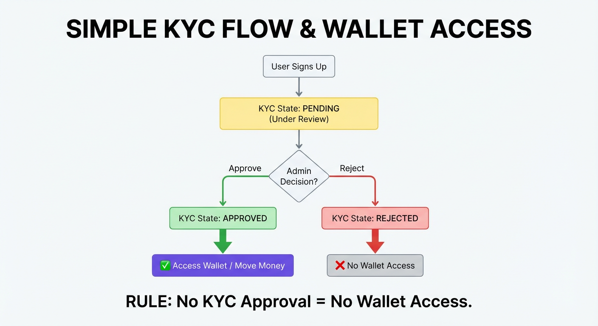

# 11. KYC Flow (Signup → Pending → Approved)

Banks do not trust users immediately.

They verify first.

This verification process is called **KYC**:
> Know Your Customer

---

## The Story

A user signs up today.

From the bank’s point of view:
- we don’t know who they are
- we don’t know if the documents are real
- we don’t know if they are allowed to transact

So we do this:

1. Signup → user exists
2. KYC submitted → status becomes **PENDING**
3. Admin reviews → **APPROVED** or **REJECTED**
4. Only approved users can use wallets

---

## KYC States 

> We use **states**, not booleans.

We use states, not booleans, because:

- Real life is not yes / no.

- Banks deal with processes, not switches.

What a Boolean Is (and Why It Fails)

A boolean gives you only two choices:

isKycApproved = true | false


That forces you into this logic:

false → not approved

true → approved

But here’s the problem…

Real Life KYC Is NOT Binary

Let’s walk through real KYC:

1. User just signed up

2. User has not submitted documents yet

3. User submitted documents

4. Admin is reviewing

5. Admin approved

6. Admin rejected

7. User resubmitted documents

Now ask yourself:

....Which of these is false?
....Which of these is true?

You cannot tell.

A boolean collapses many real situations into one unclear state.

The Bug This Creates...

Imagine this code:
```ts
if (!user.isKycApproved) {
  return "You are not approved";
}
```


Now consider two users:

- User A

Just signed up

Has never submitted KYC

- User B

Submitted fake documents

Was rejected by admin

Both users have:

isKycApproved = false


...But they are not the same situation.

Yet your system treats them the same.

That’s a logic bug, not a coding bug.

**PENDING → APPROVED → REJECTED**

A user must always be in one state.

```ts
Database Design

Migration


📄 apps/api/src/db/migrations/0003_kyc.sql

CREATE TYPE kyc_status AS ENUM (
  'PENDING',
  'APPROVED',
  'REJECTED'
);

ALTER TABLE users
ADD COLUMN kyc_status kyc_status NOT NULL DEFAULT 'PENDING';

```
Explanation...

- ENUM ensures only valid states exist

- default is PENDING

- admin action changes the state


```ts
KYC Submission (User Side)
📄 apps/api/src/handlers/kyc/submit.ts


import { requireAuth } from "../../lib/auth";
import { pool } from "../../db/client";

export async function submitKyc(req: any, res: any) {
  const auth = requireAuth(req, res);
  if (!auth) return;

  // In real life: documents, IDs, etc.
  // For this book: we simulate submission

  await pool.query(
    `UPDATE users SET kyc_status = 'PENDING' WHERE id = $1`,
    [req.userId]
  );

  res.writeHead(200, { "Content-Type": "application/json" });
  res.end(JSON.stringify({ status: "PENDING" }));
}

```
Explanation...

- user must be logged in

- we simulate KYC submission

- status stays PENDING until admin acts


```ts
Admin Review (Approve / Reject)
📄 apps/api/src/handlers/admin/kyc-review.ts


import { pool } from "../../db/client";

export async function reviewKyc(req: any, res: any) {
  const { userId, decision } = req.body;

  if (!["APPROVED", "REJECTED"].includes(decision)) {
    res.writeHead(400);
    res.end("Invalid decision");
    return;
  }

  await pool.query(
    `UPDATE users SET kyc_status = $1 WHERE id = $2`,
    [decision, userId]
  );

  res.writeHead(200);
  res.end("KYC updated");
}

```
Rule (Memorize)!!!

No KYC approval → no wallet → no money movement

