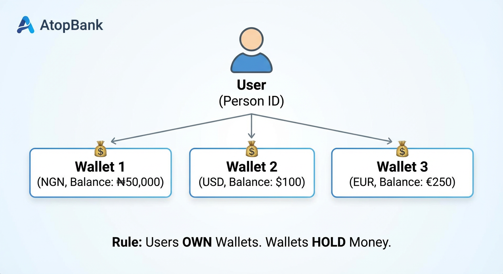

# 12. Accounts & Wallets 

This chapter is important.

If someone misunderstands **accounts and wallets**,  they will misunderstand **everything else in banking**.

So we will go slowly.

---

## First, Let’s Clear the Confusion

Many beginners think:

> “A user **is** an account.”

That is **wrong**.

### In banking:

- A **user** is a *person*
- A **wallet (account)** is a *container for money*

A person can have **many containers**.

---

## A Real-Life Story

Imagine a man named John.

John has:
- one savings account
- one current account
- one dollar account

But John is still **one person**.

So in banking:

User → owns → many wallets

yaml
Copy code

Not the other way around.

---

## Mental Model 

Think of it like this:

- **User** = person (identity)
- **Wallet** = box that holds money
- **Balance** = number written on the box

Money does **not** live on the user.  
Money lives in the **wallet**.

---

## Why Banks Separate Users and Wallets

Banks do this separation for **power and safety**.

Because:
- a user can hold money in different currencies
- a user can close one wallet without deleting their identity
- transactions always target wallets, not people

This design scales.

---

## AtopBank Rules 

In AtopBank:

1. A user must be **KYC approved**
2. Only approved users can create wallets
3. Each wallet:
   - belongs to one user
   - has one currency
   - has one balance

---

## Database Design (Let’s Read It Slowly...)

📄 `apps/api/src/db/migrations/0004_wallets.sql`

```sql
CREATE TABLE wallets (
  id UUID PRIMARY KEY,
  user_id UUID NOT NULL REFERENCES users(id),
  currency TEXT NOT NULL,
  balance_kobo BIGINT NOT NULL DEFAULT 0,
  created_at TIMESTAMPTZ NOT NULL DEFAULT now(),
  UNIQUE (user_id, currency)
);
```
Line-by-line Explanation...

**id UUID PRIMARY KEY**

 unique ID for the wallet

**user_id UUID NOT NULL REFERENCES users(id)**

this wallet belongs to a user

database enforces that the user must exist

**currency TEXT NOT NULL**

NGN, USD, EUR, etc.

one wallet = one currency

**balance_kobo BIGINT**

money is stored as smallest unit

no decimals (very important for money safety)

**DEFAULT 0**

wallets start empty

**UNIQUE (user_id, currency)**

user cannot have two NGN wallets

prevents duplication bugs

---


Wallet Lifecycle 

A wallet goes through these stages:

Created

Balance increases (credits/ Top-up)


Balance decreases (debits)


Possibly closed later.


....But a wallet never moves between users.

**Creating a Wallet**...

A user presses:

“Create Wallet”

So the server must:

Check user is logged in

Check user is KYC approved

Create wallet if not already existing

Create Wallet Handler

```ts
📄 apps/api/src/handlers/wallets/create.ts


import { requireAuth } from "../../lib/auth";
import { pool } from "../../db/client";

export async function createWallet(req: any, res: any) {
  const auth = requireAuth(req, res);
  if (!auth) return;

  const { currency } = req.body;

  if (!currency) {
    res.writeHead(400);
    res.end("currency is required");
    return;
  }

  const result = await pool.query(
    `
    INSERT INTO wallets (id, user_id, currency)
    VALUES (gen_random_uuid(), $1, $2)
    RETURNING *
    `,
    [req.userId, currency]
  );

  res.writeHead(201, { "Content-Type": "application/json" });
  res.end(JSON.stringify({ wallet: result.rows[0] }));
}
```
Explaining the Code...

**requireAuth**

ensures user is logged in

gives us req.userId

**currency**

tells us which wallet to create

**INSERT INTO wallets**

creates a new container for money

**RETURNING**

Postgres gives us the created wallet back

**201 Created**

correct HTTP response for creation

---

Why We Don’t Allow Duplicate Wallets
Because of this rule:
```sql
UNIQUE (user_id, currency)
```
If a user tries to create:

two NGN wallets

Postgres will stop it.

This is database-level safety.

Listing Wallets (Dashboard)
Users want to see:

- all wallets

- balances

- currencies

List Wallets Handler

📄 apps/api/src/handlers/wallets/list.ts

```sql
import { requireAuth } from "../../lib/auth";
import { pool } from "../../db/client";

export async function listWallets(req: any, res: any) {
  const auth = requireAuth(req, res);
  if (!auth) return;

  const result = await pool.query(
    `
    SELECT id, currency, balance_kobo, created_at
    FROM wallets
    WHERE user_id = $1
    ORDER BY created_at
    `,
    [req.userId]
  );

  res.writeHead(200, { "Content-Type": "application/json" });
  res.end(JSON.stringify({ wallets: result.rows }));
}
```

>Important Rule (Memorize This)

Users do not hold money.
Wallets hold money.

This single idea makes:

- transfers easier

- ledgers possible

- statements accurate

- systems scalable

**How This Connects to Other Chapters**

- Transfers move money between wallets

- Cards spend money from wallets

- Statements summarize wallet activity

- Payees point to wallets, not users

- Everything revolves around wallets.

>Checkpoint

You understand this chapter when you can answer:

Why is a user not a wallet?

Why does money live in wallets?

Why do we store balance as kobo?

Why enforce one wallet per currency?

If you can answer those, you’re thinking like a bank engineer.

