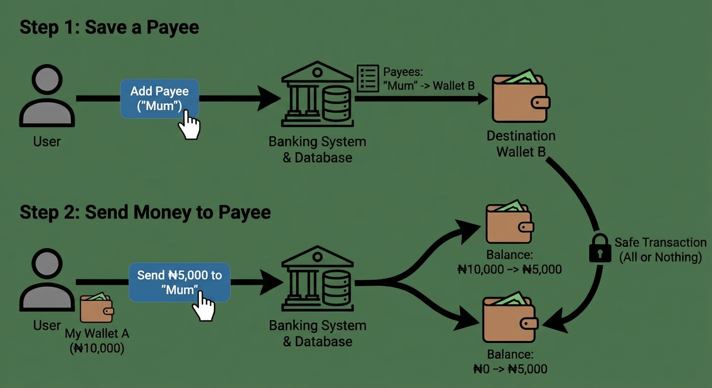

# 13. Payees & Send Money
In banking apps, people don’t want to type long account details every time.

They want something simple like:

- “Mum”
- “Landlord”
- “My savings”
- “My business account”

That saved person is called a **Payee**.

A payee is just:

> “A saved destination where I often send money.”

---

## A Simple Story

Imagine you are using a banking app.

You send money to your mum every week.

If you must type her account details every time:
- you will make mistakes
- you will send money to the wrong place
- you will hate the app

So the app lets you **save** her once.

Next time, you just select “Mum” → send.

That saved destination is a **payee**.

---

## What a Payee Is (In AtopBank)

In AtopBank, a payee is:

- owned by a user
- has a display name (e.g. “Mum”)
- points to a wallet to receive money

So the relationship is:

User → has many payees
Payee → points to one wallet


---

## Database Table: `payees`

📄 `apps/api/src/db/migrations/0005_payees.sql`

```sql
CREATE TABLE payees (
  id UUID PRIMARY KEY,
  user_id UUID NOT NULL REFERENCES users(id),
  name TEXT NOT NULL,
  wallet_id UUID NOT NULL,
  created_at TIMESTAMPTZ NOT NULL DEFAULT now()
);
```
Explain each column..

**id UUID**

unique ID for the payee

**user_id**

the owner of this payee

so different users can each have their own payees list

**name**

what the user calls the payee (“Mum”, “Boss”, “Rent”)

**wallet_id**

where the money should go

in AtopBank, money moves wallet → wallet

so the payee stores a wallet destination

**created_at**

when it was saved

**Notice**: We save the destination as a wallet, not a user.
Because money moves between wallets.

Endpoint: Add Payee

The user clicks: “Add Payee”

We save it in the database.

📄 apps/api/src/handlers/payees/add.ts

```sql
import { requireAuth } from "../../lib/auth";
import { pool } from "../../db/client";

export async function addPayee(req: any, res: any) {
  // 1) Must be logged in
  const auth = requireAuth(req, res);
  if (!auth) return;

  // 2) Read input
  const { name, walletId } = req.body;

  // 3) Basic validation
  if (!name || !walletId) {
    res.writeHead(400, { "Content-Type": "application/json" });
    res.end(JSON.stringify({ error: "name and walletId are required" }));
    return;
  }

  // 4) Save payee
  const result = await pool.query(
    `
    INSERT INTO payees (id, user_id, name, wallet_id)
    VALUES (gen_random_uuid(), $1, $2, $3)
    RETURNING *
    `,
    [req.userId, name, walletId]
  );

  // 5) Respond
  res.writeHead(201, { "Content-Type": "application/json" });
  res.end(JSON.stringify({ payee: result.rows[0] }));
}
```

Explaning the code...

requireAuth(req, res): 
This is our “bouncer”.

If the user has no access token → 401 Unauthorized

If token is valid → it puts req.userId

So now we know who owns this payee.

const { name, walletId } = req.body
This is what the frontend sends.

Example:

```sql
{
  "name": "Mum",
  "walletId": "some-wallet-uuid"
}
```
**Validation:**

We stop early if the user forgot required fields.

**INSERT INTO payees ...**

This stores the new payee.

**$1, $2, $3**

These placeholders stop SQL injection.

**RETURNING**

Postgres returns the newly created payee.

> What Happens Next? (Sending Money)...

Now the user has saved a payee.

Next they want to send money.

They click:

“Send” -> choose a payee -> enter amount

That action is a transfer.

Why Sending Money Must Use a Transaction...

Sending money means:

1. subtract from sender wallet

2. add to receiver wallet

If only step 1 happens → money disappears.

So sending money MUST follow **Chapter 10 transactions:**

Either both steps happen, or neither happens. That’s why we reuse withTransaction().

Transfer Endpoint (Payee-Based)
Here is how we send money using a payee.

📄 apps/api/src/handlers/transfers/send.ts

```sql
import { requireAuth } from "../../lib/auth";
import { withTransaction } from "../../db/tx";
import { pool } from "../../db/client";

export async function sendMoney(req: any, res: any) {
  const auth = requireAuth(req, res);
  if (!auth) return;

  const { fromWalletId, payeeId, amountKobo } = req.body;

  if (!fromWalletId || !payeeId || !amountKobo) {
    res.writeHead(400, { "Content-Type": "application/json" });
    res.end(JSON.stringify({ error: "fromWalletId, payeeId, amountKobo required" }));
    return;
  }

  // 1) Find payee destination wallet
  const payeeResult = await pool.query(
    `
    SELECT wallet_id
    FROM payees
    WHERE id = $1 AND user_id = $2
    `,
    [payeeId, req.userId]
  );

  const payee = payeeResult.rows[0];
  if (!payee) {
    res.writeHead(404, { "Content-Type": "application/json" });
    res.end(JSON.stringify({ error: "payee not found" }));
    return;
  }

  const toWalletId = payee.wallet_id;

  // 2) Transfer using a transaction (safe)
  await withTransaction(async (client) => {
    // subtract from sender
    await client.query(
      `
      UPDATE wallets
      SET balance_kobo = balance_kobo - $1
      WHERE id = $2 AND user_id = $3
      `,
      [amountKobo, fromWalletId, req.userId]
    );

    // add to receiver
    await client.query(
      `
      UPDATE wallets
      SET balance_kobo = balance_kobo + $1
      WHERE id = $2
      `,
      [amountKobo, toWalletId]
    );
  });

  res.writeHead(200, { "Content-Type": "application/json" });
  res.end(JSON.stringify({ status: "sent" }));
}

```

Explaning Sending Money...

Step A: confirm user is logged in
That’s requireAuth.

Step B: find the payee destination wallet
We look up the payee.

Important rule:
We only allow you to use payees you own.

That’s why we query:

```sql
WHERE id = $1 AND user_id = $2
```

Step C: run transfer inside withTransaction
That guarantees:

if subtract works and add fails → rollback happens

no half transfers!!!

Important Safety Note (Next Chapter Improvement)

This transfer code still needs:

- “don’t let balance go negative”

- concurrency locks (to avoid double-spend)

- ledger entries (real banking)

But for learning, this is the correct order:

payees

transaction transfer




>Checkpoint
You are done when:

- You can add a payee
- Payee is stored under the logged-in user
- You can send money to payee
- Transfer uses a transaction (no half transfers)