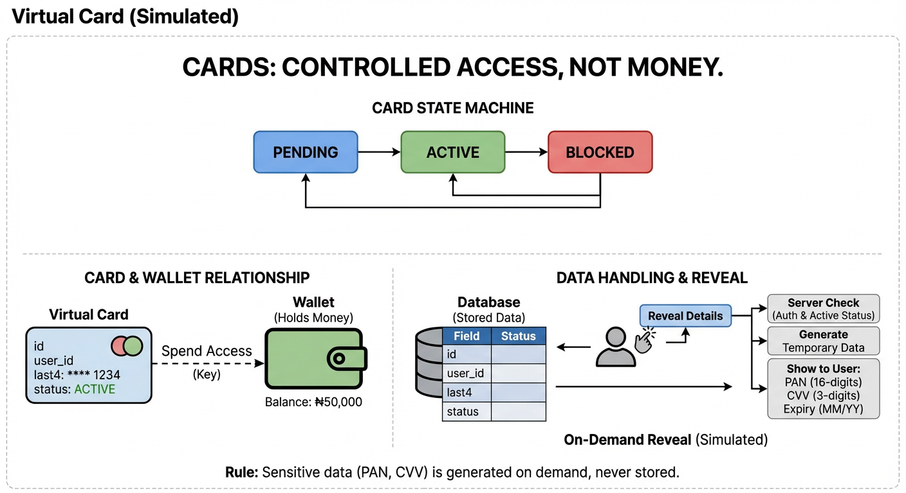

# 14. Cards (Virtual, Simulated)

Cards are **not money**.

Cards are **controlled access** to money.

A wallet holds money.  

A card is just a *key* that can spend from that wallet.

---

## First: Think Like a Bank

When a bank issues a card, the bank asks:

- Who owns this card?
- Is this card active?
- Is this card blocked?
- Can the card details be revealed?
- Can the card spend money?

So a card is really a **state machine**.

---

## Card States (Very Important)

Every card must be in **one** of these states:

PENDING → ACTIVE → BLOCKED

yaml
Copy code

### Meaning:
- **PENDING**  
  Card is issued but not yet usable
- **ACTIVE**  
  Card can be used
- **BLOCKED**  
  Card exists but is disabled

Cards **never** skip states randomly.

---

## Card Data (What We Store)

We **DO NOT** store real card numbers.

This is a learning project, so we **simulate**.

### Stored fields:
- `id` → card identifier
- `user_id` → owner
- `last4` → display only (e.g. **** 1234)
- `status` → PENDING | ACTIVE | BLOCKED

Sensitive data (PAN, CVV):
- is **generated on reveal**
- is **never stored permanently**

This mirrors how real systems work.

---

## Database (Recap)

```sql
CREATE TYPE card_status AS ENUM ('PENDING', 'ACTIVE', 'BLOCKED');

CREATE TABLE cards (
  id UUID PRIMARY KEY,
  user_id UUID NOT NULL REFERENCES users(id),
  last4 TEXT NOT NULL,
  status card_status NOT NULL DEFAULT 'PENDING',
  created_at TIMESTAMPTZ NOT NULL DEFAULT now()
);
```
Card API
These are the endpoints:

```code
GET    /v1/cards
GET    /v1/cards/:id
GET    /v1/cards/:id/reveal
POST   /v1/cards/:id/block
POST   /v1/cards/:id/unblock
```
Each one answers one clear question.

1. List Cards
```code
Endpoint: GET /v1/cards
Authorization: Bearer ACCESS_TOKEN
```
What the user is asking
“Show me all my cards.”

What the server must ensure
- User is authenticated

- Only return their own cards

- Do not expose sensitive details

Handler
📄 apps/api/src/handlers/cards/list.ts

```ts
import { requireAuth } from "../../lib/auth";
import { pool } from "../../db/client";

export async function listCards(req: any, res: any) {
  const auth = requireAuth(req, res);
  if (!auth) return;

  const result = await pool.query(
    `
    SELECT id, last4, status, created_at
    FROM cards
    WHERE user_id = $1
    ORDER BY created_at DESC
    `,
    [req.userId]
  );

  res.writeHead(200, { "Content-Type": "application/json" });
  res.end(JSON.stringify({ cards: result.rows }));
}
```
Explaining...

- We authenticate the user

- We query only cards where user_id = req.userId

- We return safe fields only

---

2. Get Card by ID
Endpoint
```code
GET /v1/cards/:id
```
What the user is asking
“Show me details of this card.”

This is used when the user clicks a card in the UI.

Handler
📄 apps/api/src/handlers/cards/get.ts
```ts
import { requireAuth } from "../../lib/auth";
import { pool } from "../../db/client";

export async function getCard(req: any, res: any) {
  const auth = requireAuth(req, res);
  if (!auth) return;

  const { id } = req.params;

  const result = await pool.query(
    `
    SELECT id, last4, status, created_at
    FROM cards
    WHERE id = $1 AND user_id = $2
    `,
    [id, req.userId]
  );

  const card = result.rows[0];
  if (!card) {
    res.writeHead(404);
    res.end("Card not found");
    return;
  }

  res.writeHead(200);
  res.end(JSON.stringify({ card }));
}
```
Why this matters...

Card ID alone is not enough

Ownership check prevents leaks

This is a core security rule

---

3. Reveal Card Details 
Endpoint
```code
GET /v1/cards/:id/reveal
```
Important Rule:

Card details are revealed only on demand, only to the owner, and only temporarily.

What We Simulate
- PAN (16-digit number)

- CVV (3-digit number)

- Expiry date

These are generated, not stored.

Handler
📄 apps/api/src/handlers/cards/reveal.ts

```ts
import crypto from "node:crypto";
import { requireAuth } from "../../lib/auth";
import { pool } from "../../db/client";

function randomDigits(length: number) {
  let result = "";
  for (let i = 0; i < length; i++) {
    result += Math.floor(Math.random() * 10);
  }
  return result;
}

export async function revealCard(req: any, res: any) {
  const auth = requireAuth(req, res);
  if (!auth) return;

  const { id } = req.params;

  const result = await pool.query(
    `
    SELECT id, status
    FROM cards
    WHERE id = $1 AND user_id = $2
    `,
    [id, req.userId]
  );

  const card = result.rows[0];
  if (!card) {
    res.writeHead(404);
    res.end("Card not found");
    return;
  }

  if (card.status !== "ACTIVE") {
    res.writeHead(403);
    res.end("Card is not active");
    return;
  }

  // simulate sensitive data
  const pan = randomDigits(16);
  const cvv = randomDigits(3);
  const expiry = "12/28";

  res.writeHead(200);
  res.end(JSON.stringify({ pan, cvv, expiry }));
}
```
Explanation...

- Only ACTIVE cards can be revealed

- PAN/CVV are generated on the fly

- Nothing sensitive is saved

This teaches:

security boundaries

ephemeral secrets

4. Block Card
Endpoint
```code
POST /v1/cards/:id/block
```
What the user is saying
“I don’t trust this card anymore.”

Blocking is reversible.

Handler
📄 apps/api/src/handlers/cards/block.ts

```ts
import { requireAuth } from "../../lib/auth";
import { pool } from "../../db/client";

export async function blockCard(req: any, res: any) {
  const auth = requireAuth(req, res);
  if (!auth) return;

  const { id } = req.params;

  await pool.query(
    `
    UPDATE cards
    SET status = 'BLOCKED'
    WHERE id = $1 AND user_id = $2
    `,
    [id, req.userId]
  );

  res.writeHead(200);
  res.end("Card blocked");
}
```

5. Unblock Card
Endpoint
```code
POST /v1/cards/:id/unblock
```
Rule:

Only blocked cards can be unblocked.

Handler
📄 apps/api/src/handlers/cards/unblock.ts

```ts
import { requireAuth } from "../../lib/auth";
import { pool } from "../../db/client";

export async function unblockCard(req: any, res: any) {
  const auth = requireAuth(req, res);
  if (!auth) return;

  const { id } = req.params;

  await pool.query(
    `
    UPDATE cards
    SET status = 'ACTIVE'
    WHERE id = $1 AND user_id = $2 AND status = 'BLOCKED'
    `,
    [id, req.userId]
  );

  res.writeHead(200);
  res.end("Card unblocked");
}
```
Summary (Very Important)

Cards in AtopBank:

- are owned

- have states

- reveal details only when safe

- never store sensitive data

- always check ownership

This is exactly how real banking systems think, just simplified.

>Checkpoint

You are done when:

- Cards list works
- Card reveal works only when ACTIVE
- Blocked cards cannot be revealed
- Ownership is always enforced

