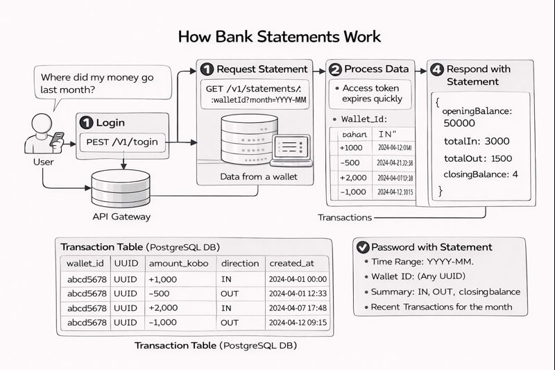

# 15. Statements & Reporting 

A bank grows trust when it can answer this question:

> “Show me exactly what happened to my money.”

That’s a **statement**.

A statement is not magic.
It is just:

- a time range (e.g. January)
- a wallet/account
- a summary (credits, debits, closing balance)
- and a list of transactions

---

## The Story

Imagine a user says:

> “I think you charged me twice.”

If you don’t have statements, you argue.

If you have statements, you **show facts**.

Statements turn confusion into clarity.

---

## What We Will Build

 `GET /v1/statements/:walletId?month=YYYY-MM` returns:
- openingBalance
- totalIn
- totalOut
- closingBalance
- txCount

---

## Database Assumption 

We assume you already have a `transactions` table like:

- `wallet_id`
- `amount_kobo` (positive number)
- `direction` = `IN` or `OUT`
- `created_at`

In summary,statement is  a summary over a period and derived from transactions

