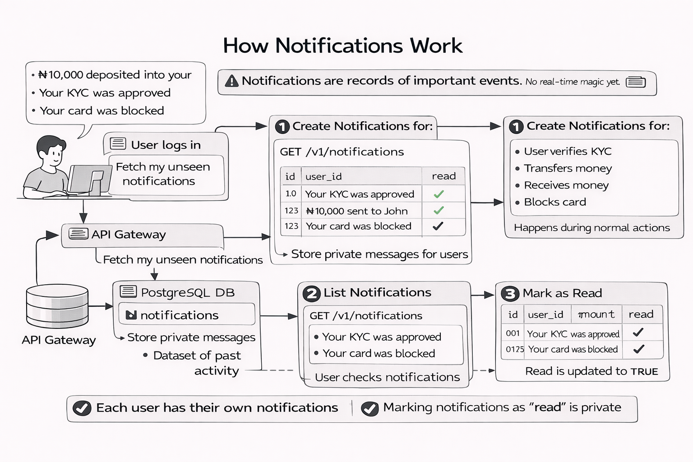

# 16. Notifications

Notifications answer one question:

> “What just happened that I should know about?”

That’s it.

Notifications are **not** emails.  
Notifications are **not** real-time magic.

They are simply **records of important events**.

---

## A Simple Story

Imagine you walk into a bank.

While you’re inside:
- money is deposited
- a card is blocked
- your KYC is approved

If nobody tells you, you feel lost.

So the bank leaves **notes for you**:

- “Your KYC has been approved”
- “₦10,000 was sent to John”
- “Your card has been blocked”

Those notes are **notifications**.

---

## What Notifications Are 

A notification is:

- tied to **one user**
- created when **something important happens**
- stored in the database
- read later by the user

Nothing more.

---

## What Notifications Are NOT

Not push notifications (yet)  
Not emails (yet)  
Not WebSockets (yet)  

For this book, notifications are:
> **database records that the frontend can fetch**

---

## What We Will Build

By the end of this chapter:

- Notifications table  
- Create notification when events happen  
- List notifications for a user  
- Mark notifications as read  

---

## Database Design 

📄 `apps/api/src/db/migrations/0007_notifications.sql`

```sql
CREATE TABLE notifications (
  id UUID PRIMARY KEY,
  user_id UUID NOT NULL REFERENCES users(id),
  message TEXT NOT NULL,
  read BOOLEAN NOT NULL DEFAULT false,
  created_at TIMESTAMPTZ NOT NULL DEFAULT now()
);

CREATE INDEX notifications_user_time_idx
ON notifications(user_id, created_at DESC);
```

Explanation...

**user_id**

→ who this notification belongs to

**message**
→ what happened (plain English)

**read**
→ has the user seen it?

**created_at**
→ when it happened

Index:

makes “list my notifications” fast

When Do We Create Notifications?

Notifications are created inside other flows.

Examples
```code
Event	Notification
KYC approved	“Your KYC has been approved”
KYC rejected	“Your KYC was rejected”
Transfer sent	“You sent ₦10,000”
Transfer received	“You received ₦10,000”
Card blocked	“Your card was blocked”
```

So notifications are side-effects, not main actions.


The frontend will:

- Fetch notifications on dashboard load

- Show unread count

- Mark as read when clicked

- No real-time needed yet.

Why This Design Is Good for a Book..

-simple tables

- clear purpose

- easy to extend later: email notifications, push notifications, WebSockets, teaches event thinking

> Checkpoint
You are done when:

- notifications are created during actions
- users can list their notifications
- notifications can be marked as read
- no user can see another user’s notifications

