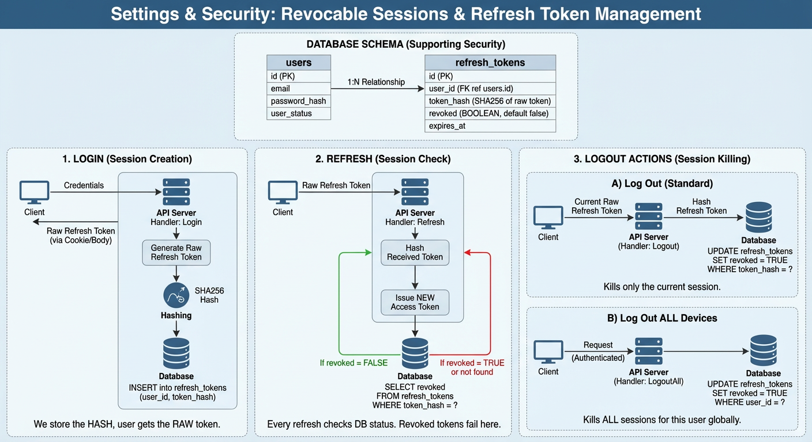

# 18. Settings & Security

This chapter is **not** about building 50 settings screens.

It’s about the *few security features every real app must have*:

- Change password
- Log out (kill a session)
- Log out all devices (kill all sessions)
- Notification preference (small example setting)

And we’ll do it in a way that matches AtopBank’s workflow:
- users sign up → may be pending
- approved users use the app
- security settings must always work for logged-in users

---

## The Story

A user thinks:

1) “I think someone knows my password.” → **Change password**  
2) “I logged in on a friend’s laptop.” → **Log out**  
3) “I lost my phone.” → **Log out all devices**

If your bank app can’t do these 3, it doesn’t feel safe.

---

## What “Sessions” Mean In Our Book

In AtopBank we use:
- **Access token** (short) → for API requests
- **Refresh token** (long) → like the *session card*

So when we say:
- “logout”  
We really mean:
> **revoke the refresh token**

Because once refresh is revoked:
- user can’t get new access tokens
- session dies naturally

---

Refresh token storage (so logout is real)

If refresh tokens are not stored, you cannot revoke them.
So we store them.

📄 apps/api/src/db/migrations/0011_refresh_tokens.

```sql

CREATE TABLE refresh_tokens (
  id UUID PRIMARY KEY,
  user_id UUID NOT NULL REFERENCES users(id),
  token_hash TEXT NOT NULL,
  revoked BOOLEAN NOT NULL DEFAULT false,
  expires_at TIMESTAMPTZ NOT NULL,
  created_at TIMESTAMPTZ NOT NULL DEFAULT now()
);

CREATE INDEX refresh_tokens_user_idx
ON refresh_tokens(user_id);
```
Explanation...

- we never store refresh token as plain text

- we store a hash of it

- if user logs out, we mark it revoked

- logout-all revokes all tokens for that user

### Part B - Token Security Helpers

We will hash refresh tokens before storing them.

📄 apps/api/src/lib/tokenHash.ts
```ts
import crypto from "node:crypto";

export function hashToken(token: string) {
  return crypto.createHash("sha256").update(token).digest("hex");
}
```

Explanation...

SHA256 is fine here because token is already random

we are not hashing passwords here (argon2 is for passwords)

### Part C - Repositories (DB functions)

📄 apps/api/src/db/repositories/settings.repo.ts
```ts
import { pool } from "../client.js";

export function getUserSettings(userId: string) {
  return pool.query(
    `SELECT email, notify_enabled, kyc_status, user_status FROM users WHERE id = $1`,
    [userId]
  );
}

export function updateNotifyEnabled(userId: string, enabled: boolean) {
  return pool.query(
    `UPDATE users SET notify_enabled = $1 WHERE id = $2 RETURNING notify_enabled`,
    [enabled, userId]
  );
}
```


📄 apps/api/src/db/repositories/tokens.repo.ts
```ts
import { pool } from "../client.js";

export function saveRefreshToken(userId: string, tokenHash: string, expiresAt: string) {
  return pool.query(
    `
    INSERT INTO refresh_tokens (id, user_id, token_hash, expires_at)
    VALUES (gen_random_uuid(), $1, $2, $3)
    `,
    [userId, tokenHash, expiresAt]
  );
}

export function findRefreshToken(tokenHash: string) {
  return pool.query(
    `
    SELECT id, user_id, revoked, expires_at
    FROM refresh_tokens
    WHERE token_hash = $1
    `,
    [tokenHash]
  );
}

export function revokeRefreshToken(tokenHash: string) {
  return pool.query(
    `UPDATE refresh_tokens SET revoked = true WHERE token_hash = $1`,
    [tokenHash]
  );
}

export function revokeAllUserTokens(userId: string) {
  return pool.query(
    `UPDATE refresh_tokens SET revoked = true WHERE user_id = $1`,
    [userId]
  );
}
```

Explanation...

- save token on login

- verify token exists + not revoked on refresh

- revoke one token on logout

- revoke all on logout-all

### Part D -  Update Login & Refresh 

Login must store refresh token

In your login success section:
```ts
import { hashToken } from "../../lib/tokenHash.js";
import { saveRefreshToken } from "../../db/repositories/tokens.repo.js";

const refreshTokenHash = hashToken(refreshToken);
const refreshExpIso = new Date((now + REFRESH_TTL) * 1000).toISOString();

await saveRefreshToken(user.id, refreshTokenHash, refreshExpIso);
```

Explanation...

- user gets refresh token

- we hash it and store the hash

- now logout becomes possible

Refresh must reject revoked tokens

In refresh handler:
```ts

import { hashToken } from "../../lib/tokenHash.js";
import { findRefreshToken } from "../../db/repositories/tokens.repo.js";

const tokenHash = hashToken(refreshToken);

const dbToken = await findRefreshToken(tokenHash);
const row = dbToken.rows[0];

if (!row || row.revoked) {
  res.writeHead(401);
  res.end("invalid refresh token");
  return;
}
```
Explanation...

even if JWT signature is valid, we still require “token exists in DB and not revoked”, that’s what makes refresh tokens revocable

### Settings Handlers
Get Settings

📄 apps/api/src/handlers/settings/get.ts
```ts
import type { Handler } from "../../types.js";
import { requireAuth } from "../../middleware/requireAuth.js";
import { getUserSettings } from "../../db/repositories/settings.repo.js";

export const getSettings: Handler = requireAuth(async (_req, res, ctx) => {
  const result = await getUserSettings(ctx.user!.id);
  const s = result.rows[0];

  res.writeHead(200, { "Content-Type": "application/json" });
  res.end(JSON.stringify({
    email: s.email,
    notifyEnabled: s.notify_enabled,
    kycStatus: s.kyc_status,
    userStatus: s.user_status
  }));
});
```

Explanation...

- user must be logged in

- we return only safe fields (not password hash)

Update Notification Preference

📄 apps/api/src/handlers/settings/notifications.ts
```ts
import type { Handler } from "../../types.js";
import { requireAuth } from "../../middleware/requireAuth.js";
import { AppError } from "../../lib/errors.js";
import { updateNotifyEnabled } from "../../db/repositories/settings.repo.js";

export const updateNotifications: Handler = requireAuth(async (req, res, ctx) => {
  const { enabled } = req.body;

  if (typeof enabled !== "boolean") {
    throw new AppError(400, "BAD_REQUEST", "enabled must be boolean");
  }

  const result = await updateNotifyEnabled(ctx.user!.id, enabled);

  res.writeHead(200, { "Content-Type": "application/json" });
  res.end(JSON.stringify({ notifyEnabled: result.rows[0].notify_enabled }));
});
```
Change Password (Safe)

📄 apps/api/src/handlers/settings/password.ts
```ts
import type { Handler } from "../../types.js";
import { requireAuth } from "../../middleware/requireAuth.js";
import { AppError } from "../../lib/errors.js";
import { pool } from "../../db/client.js";
import { verifyPassword, hashPassword } from "../../lib/password.js";

export const changePassword: Handler = requireAuth(async (req, res, ctx) => {
  const { currentPassword, newPassword } = req.body;

  if (!currentPassword || !newPassword) {
    throw new AppError(400, "BAD_REQUEST", "currentPassword and newPassword required");
  }

  const userRes = await pool.query(
    `SELECT password_hash FROM users WHERE id = $1`,
    [ctx.user!.id]
  );

  const ok = await verifyPassword(userRes.rows[0].password_hash, currentPassword);
  if (!ok) throw new AppError(401, "INVALID_PASSWORD", "Current password is wrong");

  const newHash = await hashPassword(newPassword);

  await pool.query(
    `UPDATE users SET password_hash = $1 WHERE id = $2`,
    [newHash, ctx.user!.id]
  );

  res.writeHead(200, { "Content-Type": "application/json" });
  res.end(JSON.stringify({ status: "ok" }));
});
```
Explanation...

- verify old password first

- then hash new password

- store new hash

- never return hashes

Logout (revoke one refresh token)

📄 apps/api/src/handlers/auth/logout.ts
```ts
import type { Handler } from "../../types.js";
import { AppError } from "../../lib/errors.js";
import { revokeRefreshToken } from "../../db/repositories/tokens.repo.js";
import { hashToken } from "../../lib/tokenHash.js";

export const logout: Handler = async (req, res) => {
  const { refreshToken } = req.body;

  if (!refreshToken) {
    throw new AppError(400, "BAD_REQUEST", "refreshToken required");
  }

  await revokeRefreshToken(hashToken(refreshToken));

  res.writeHead(204);
  res.end();
};
```
Explanation...

- refresh token is the “session”

- logout means “kill this session”, so we revoke it

Logout All Devices (revoke all)

📄 apps/api/src/handlers/settings/logout-all.ts
```ts
import type { Handler } from "../../types.js";
import { requireAuth } from "../../middleware/requireAuth.js";
import { revokeAllUserTokens } from "../../db/repositories/tokens.repo.js";

export const logoutAll: Handler = requireAuth(async (_req, res, ctx) => {
  await revokeAllUserTokens(ctx.user!.id);

  res.writeHead(200, { "Content-Type": "application/json" });
  res.end(JSON.stringify({ status: "ok" }));
});
```

Explanation..

- user stays logged in on many devices; this endpoint kills all sessions

### Routes


{ method: "GET",  path: "/v1/settings", handler: getSettings },

{ method: "POST", path: "/v1/settings/password", handler: changePassword },

{ method: "POST", path: "/v1/settings/notifications", handler: updateNotifications },

{ method: "POST", path: "/v1/settings/logout-all", handler: logoutAll },

{ method: "POST", path: "/v1/auth/logout", handler: logout },

